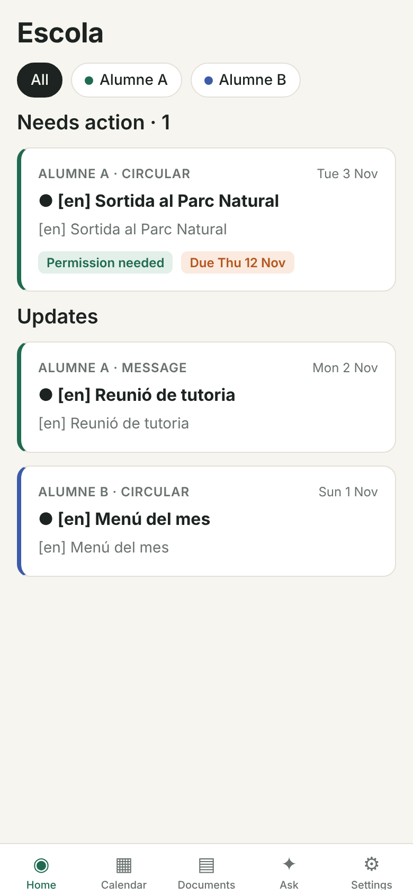

# Escola (working name): GestIB parent app

School messages from GestIB Famílies, translated into the parent's language, with the original always one tap
away. Built from `SPEC.md` (source of truth) following `CLAUDE.md`.



## What works today

The whole product runs end to end against a **mock GestIB portal**: sign up, consent, link GestIB, first sync,
translated feed, item detail with original toggle, attachments, calendar, documents, assistant, settings, and
replying to the school through the preview-and-confirm flow. `scripts/walkthrough.ts` drives all of it in a real
browser at phone size; screenshots are in `docs/screenshots/`.

| Area | State |
|---|---|
| Phone app (Expo SDK 58, iOS/Android/web) | All SPEC §11 screens except paywall. UI in en/es/ca/de/fr |
| API (Fastify) | Every SPEC §7 endpoint except uploads, digests, `calendar.ics` |
| Worker (BullMQ + Playwright) | Scheduler, sync, enrich, notify, submit; session reuse; lockout guard |
| AI | Bedrock EU provider (Anthropic models + Cohere multilingual embeddings), offline fake for dev/tests |
| Push | Expo push, per-guardian locale, batching, quiet hours, lock-screen privacy |
| Data | Postgres 16 + pgvector, forced RLS per family, envelope-encrypted credentials and cookies |
| **Real GestIB** | **Not connected yet.** Needs your fixture capture (below) |

87 automated tests: unit, Postgres, API, and real-Chromium runs of the worker against the mock portal.

## Guarantees enforced in code and tests
- **No invented GestIB internals.** Real selectors are placeholders; the adapter refuses to run until they come from captured pages.
- **Password tried once** (twice only when the result page is ambiguous), then the account stops and the parent is told. Saved cookies are reused so most syncs send no password at all.
- **Nothing is sent to school without confirmation.** The preview hash must match what is sent, the portal form must echo it, a DB trigger blocks unconfirmed submissions, any edit invalidates the confirmation, and a send is never retried.
- **Families are isolated** by forced Postgres row-level security.
- **The API can only encrypt** credentials; only the worker can decrypt, in memory, and wipes them after use.
- **No secrets or child content in logs.** Tests grep the logs for the password.
- **Original text is always stored and shown** next to translations.

## Run it locally
Needs Node 20+, pnpm, Postgres 16 with pgvector, Redis, Chrome or Playwright Chromium.
```bash
pnpm i
cp .env.example .env            # fill LOCAL_KMS_KEY and JWT_SECRET (commands in the file)
pnpm stack:up                   # mock GestIB + API + worker + web app on :8081
pnpm walkthrough                # optional: drives the whole app in Chrome, saves screenshots
pnpm test                       # set TEST_DATABASE_URL for the Postgres/API/pipeline tests
```
Open http://localhost:8081, sign in with any email (the magic link is printed in `.data/logs/api.log`),
and link GestIB with the mock login `parent1` / `escola123`. On a phone: `pnpm --filter @escola/mobile start`
and open it in Expo Go (set `EXPO_PUBLIC_API_URL` to your machine's IP).

## Deploy (beta)
- **Backend + web app:** `render.yaml` is a Render Blueprint (Frankfurt): Postgres 16 + pgvector, Redis, API, worker (Docker with Chromium), and the web build of the app. Connect the GitHub repo in Render, fill the `sync: false` secrets once (`LOCAL_KMS_KEY`, `APP_URL`, `PUBLIC_API_URL`, `EXPO_PUBLIC_API_URL`), deploy.
- **Phone builds:** `apps/mobile/eas.json`: `beta` profile gives an Android APK to share directly and an iOS internal build (TestFlight needs the Apple Developer account).
- Migrations run on every API start and work on a managed, non-superuser Postgres (tested).

## What is left before real parents can use it
1. **Capture GestIB pages (you, about 30 minutes).** Follow `docs/SELECTOR_DISCOVERY.md`. Then real selectors get written and the read-only canary runs against your account. Replying stays switched off until it is verified on a real account.
2. **Choose EU vendors** (`docs/OPEN_QUESTIONS.md` #16): hosting, KMS (only a local dev KMS exists), Bedrock region and model IDs, email.
3. **Legal**: CAIB position on automated access, entity, ToS/Privacy, DPIA (`docs/DPIA.md`).
4. **Not built yet**: RevenueCat paywall in the app (webhook exists), email/WhatsApp digest, document upload and the other write types, `.ics` feed, EAS build config, Maestro flows.

## Layout
```
apps/mobile         Expo app (src/app routes, src/i18n, src/lib)
apps/api            Fastify API
apps/mock-portal    synthetic GestIB stand-in for dev and tests
workers/sync        adapter, lockout guard, sync, enrich, notify, submit, BullMQ main
packages/shared     enums, Zod schemas, redact(), preview hash
packages/db         Drizzle schema, migrations (up/down), RLS
packages/crypto     envelope encryption, KMS wrap/unwrap split
packages/llm        providers (Bedrock EU / fake), enrichment + drafting prompts
packages/storage    S3 (EU, SSE-KMS) or local blob store with signed URLs
scripts             stack, walkthrough, anonymiser, GestIB session recorder
docs                SELECTOR_DISCOVERY, OPEN_QUESTIONS, DPIA, RUNBOOK, screenshots
```
