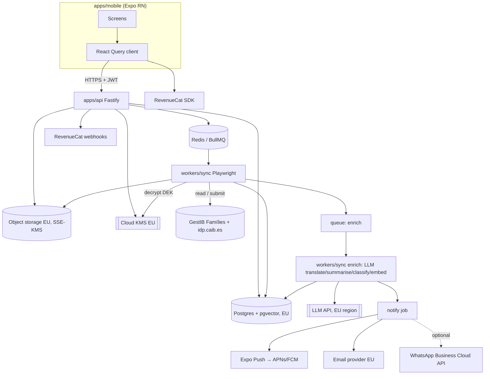

# GestIB Parent App — Technical Specification (v0.1, 4 Nov 2026)

Working name: **Escola** (placeholder). Audience: Claude Code building the first version.
Legend: **[ASSUMPTION]** = unverified decision; **[TBD]** = TO BE DISCOVERED from the real portal; **[OPEN]** = needs a human decision.

---

## 1. Product summary

An iPhone + Android app for parents whose children attend Balearic public schools using **GestIB Famílies**. The app:

1. Stores the parent's GestIB login in an encrypted EU vault (with consent).
2. Runs a server-side sync worker that logs in for them, re-logs in after the overnight session expiry, scrapes every section for each child, detects new items and downloads attachments.
3. Translates + summarises each item into the parent's language (original always viewable), classifies it as **Needs action** or **Info**, extracts deadlines.
4. Sends short, readable push notifications; shows a per-child feed, documents library, calendar.
5. Offers an in-app AI assistant answering questions over the parent's synced data (RAG) plus general school info.
6. **Reception (write-back):** parent fills forms in their language → app shows translated preview + exact original-language text to be submitted → explicit confirmation → worker submits in GestIB → verifies → stores receipt + audit log. **Consents are never auto-approved.**
7. Optional email / WhatsApp digest; subscriptions via RevenueCat.

Non-goals for v1: online enrolment (matrícula), Cl@ve / digital-certificate logins (cannot be automated), other regions' portals (designed for via adapters, not built).

## 2. Source system: what we know vs don't

Known (observed by the founder's own account):

- Base: `https://www3.caib.es/xestibback/families/*`
- Login: two-step at `idp.caib.es` — page 1 username, page 2 password form (`https://idp.caib.es/passwordLoginForm`). Session expires overnight. Password policy: 6–30 chars, ≥1 digit, starts with a letter, no ñ/ç/accents/symbols, 365-day expiry, forced change screens exist.
- Section slugs under `/xestibback/families/`: `home`, `missatges`, `circulars`, `autoritzacions`, `notificacions`, `calendariEscolar`, `horari`, `activitats`, `assistencia`, `qualificacions`, `notesParcials`, `valoracions`.
- Other areas (slug **[TBD]**): "Visualiza y justifica" (absences), "Envía documentación al centro", cuestionarios, encuestas, reuniones.
- Multiple children per account, switched via "Otros alumnos" (mechanism **[TBD]**: query param, POST, or session state).
- Content language: Catalan and/or Spanish (UI language may be switchable **[TBD]**).
- Some surveys link to external Google Forms.

Unknown — must be discovered, never invented: all DOM selectors, item IDs, pagination, attachment URL patterns, CSRF/hidden fields, form field names, submission confirmation markers, captcha/rate limits, lockout threshold, error-message texts beyond "invalid username or password", whether a JSON backend exists behind pages.

## 3. Architecture



Flow: scheduler enqueues `sync(account)` → worker logs in (or reuses session) → adapter returns normalised items → diff by content hash → new items stored + attachments uploaded → `enrich` job → `notify` job.

## 4. Tech stack

| Layer            | Choice                                                                                                                                                                                                                                                  |
| ---------------- | ------------------------------------------------------------------------------------------------------------------------------------------------------------------------------------------------------------------------------------------------------- |
| Mobile           | Expo (SDK latest), React Native, TypeScript, Expo Router, React Query, Zustand, i18next, expo-notifications, expo-secure-store (JWT only), expo-document-picker / image-picker, react-native-pdf or WebView viewer, RevenueCat `react-native-purchases` |
| API              | Node 20, Fastify, Zod, Drizzle ORM, Postgres 16 + pgvector, BullMQ/Redis, pino (with redaction)                                                                                                                                                         |
| Worker           | Playwright Chromium (headless), same packages; one browser context per account, never shared                                                                                                                                                            |
| Auth (app users) | Email magic link + Sign in with Apple / Google; JWT (15 min) + refresh token (30 d, rotating)                                                                                                                                                           |
| Crypto           | Cloud KMS (EU region; e.g. AWS KMS eu-west-3/eu-south-2 or GCP KMS europe-southwest1 **[OPEN]**), AES-256-GCM envelope encryption                                                                                                                       |
| LLM              | EU-region endpoint (e.g. Anthropic via AWS Bedrock EU or Azure OpenAI EU **[OPEN]**); embeddings model in EU                                                                                                                                            |
| Hosting          | EU only (Fly.io Madrid/Paris, or AWS eu-south-2) **[OPEN]**                                                                                                                                                                                             |
| Observability    | Sentry (EU data region, PII scrubbing), OpenTelemetry, uptime + "parser drift" alerts                                                                                                                                                                   |
| Email            | Postmark/Resend EU or AWS SES EU **[OPEN]**                                                                                                                                                                                                             |

## 5. Repo structure

```
/ (pnpm + turbo)
├─ apps/
│  ├─ mobile/            Expo app (app/ routes, components/, features/, i18n/)
│  ├─ api/               Fastify (routes/, services/, plugins/auth, webhooks/)
│  └─ mock-portal/       Express server replaying recorded GestIB HTML fixtures + simulating login, expiry, errors, submissions
├─ workers/
│  └─ sync/
│     ├─ src/core/        scheduler, session manager, diff, attachment store, lockout guard
│     ├─ src/adapters/
│     │   ├─ types.ts     PortalAdapter interface
│     │   └─ gestib/      login.ts, sections/*.ts, selectors.ts ([TBD] values), submit/*.ts
│     ├─ src/enrich/      translate, summarise, classify, embed
│     └─ src/notify/      push, email, whatsapp
├─ packages/
│  ├─ shared/            Zod schemas, enums, types, i18n keys
│  ├─ db/                Drizzle schema + migrations
│  ├─ crypto/            envelope encryption helpers (KMS abstraction + local dev KMS)
│  └─ llm/               provider abstraction, prompts, eval fixtures
├─ fixtures/gestib/      recorded, ANONYMISED HTML per section + README on capture
├─ docs/ (DPIA.md, OPEN_QUESTIONS.md, RUNBOOK.md, SELECTOR_DISCOVERY.md)
├─ SPEC.md, CLAUDE.md
```

## 6. Data model (Postgres)

All tables: `id uuid pk`, `created_at`, `updated_at`. Child-content tables are row-scoped by `family_id`; enforce with Postgres RLS using `app.family_id` session var.

- **users**: email (unique), display_name, locale (`en`,`es`,`ca`,`de`,`fr`,`it`,`nl`,`ru`,`uk`,`ar`,`zh`… initial set en/es/de/fr **[ASSUMPTION]**), auth_providers jsonb, deleted_at.
- **families**: name, owner_user_id, subscription_status (`trial|active|grace|expired`), revenuecat_app_user_id.
- **family_members**: family_id, user_id, role (`owner|guardian|viewer`), can_submit bool, notification_prefs jsonb. (Multiple guardians; co-parent sees data without seeing the password.)
- **portal_accounts**: family_id, portal (`gestib`), username_hint (masked), status (`active|needs_login_help|credentials_invalid|locked|password_expired|paused|disabled`), last_login_at, last_sync_at, last_error_code, consecutive_auth_failures int, sync_interval_min.
- **credentials**: portal_account_id (1:1), ciphertext bytea, iv, auth_tag, wrapped_dek bytea, kms_key_id, key_version, created_by_user_id, rotated_at. (Username + password encrypted together.)
- **portal_sessions**: portal_account_id, encrypted_storage_state bytea (Playwright cookies, same envelope), expires_at_estimate, invalidated_at.
- **children**: family_id, portal_account_id, portal_child_ref (opaque **[TBD]**), display_name, school_name, class_label, colour.
- **items**: child_id (nullable for account-wide), section (`message|circular|authorisation|notification|calendar_event|timetable|activity|attendance|grade|partial_grade|assessment|questionnaire|survey|meeting|other`), portal_item_ref, content_hash, original_title, original_body (html sanitised + text), original_lang, sender, posted_at, raw_snapshot_key (S3), first_seen_at, is_read_by jsonb, status (`new|seen|archived`).
- **item_translations**: item_id, lang, title, body, summary (≤140 chars), model, prompt_version, quality_flags.
- **item_actions**: item_id, kind (`reply|consent|justify_absence|upload_document|answer_survey|book_meeting|pay|read_only_external`), deadline_at, deadline_source (`parsed|llm|portal_field`), confidence, state (`open|done_in_app|done_elsewhere|expired|dismissed`).
- **attachments**: item_id, filename, mime, size, sha256, s3_key, portal_url_ref (encrypted), translated_summary.
- **calendar_entries**: child_id, item_id?, title_original, title_translated, starts_at, ends_at, all_day, kind.
- **submissions**: family_id, child_id, item_id?, kind, user_input (parent language), user_lang, draft_original (ca/es text actually sent), payload jsonb (field→value, **[TBD]** mapping), files jsonb, state (`draft|awaiting_confirmation|confirmed|queued|submitting|verifying|succeeded|failed|needs_manual`), error_code, attempts (max 1 automatic for non-idempotent writes).
- **submission_confirmations**: submission_id, user_id, confirmed_at, device_id, ip_hash, preview_hash (hash of exact text/payload shown), consent_text_version.
- **receipts**: submission_id, screenshot_s3_key, page_text_after, portal_confirmation_ref, verified_at.
- **audit_log** (append-only): actor (`user|worker|system|admin`), actor_id, family_id, action, target, metadata (no secrets), at.
- **devices**: user_id, expo_push_token, platform, locale, last_seen.
- **notifications**: user_id, item_id?, channel (`push|email|whatsapp`), kind, title, body, sent_at, status, collapse_key.
- **digests**: family_id, recipient (email/phone, encrypted), channel, cadence (`only_when_new_daily|weekly`), send_time_local, active.
- **consents** (GDPR/ToS): user_id, kind (`tos|privacy|mandate_read|mandate_submit|ai_processing|marketing`), version, granted_at, revoked_at.
- **embeddings**: family_id, item_id, chunk_idx, text, vector vector(1536 **[depends on model]**).
- **chat_threads / chat_messages**: family_id, user_id, role, content, cited_item_ids uuid[].
- **sync_runs**: portal_account_id, started_at, finished_at, result, sections jsonb (counts, durations, parse errors), adapter_version.
- **data_requests**: user_id, kind (`export|delete`), state, file_s3_key, completed_at.

## 7. API endpoints (REST, `/v1`, JSON, Zod-validated; all require JWT unless noted)

Auth: `POST /auth/magic-link`, `POST /auth/verify`, `POST /auth/oauth/{apple|google}`, `POST /auth/refresh`, `POST /auth/logout`.
Me/family: `GET /me`, `PATCH /me` (locale, name), `GET /family`, `POST /family/invites` (email, role), `POST /family/invites/{token}/accept`, `DELETE /family/members/{id}`.
Consents: `GET /consents`, `POST /consents` {kind, version}, `DELETE /consents/{kind}`.
Portal account: `POST /portal-accounts` {portal, username, password} → encrypts immediately, enqueues `verify_login` (one attempt), returns status; `PUT /portal-accounts/{id}/credentials`; `GET /portal-accounts/{id}` (status, last sync, error); `POST /portal-accounts/{id}/sync` (manual, rate-limited 1/10 min); `POST /portal-accounts/{id}/pause|resume`; `DELETE /portal-accounts/{id}` (wipes credentials + sessions).
Children: `GET /children`, `PATCH /children/{id}` (display name, colour).
Feed: `GET /items?child_id&section&needs_action&since&cursor`, `GET /items/{id}` (translation + original + actions + attachments), `POST /items/{id}/read`, `POST /items/{id}/actions/{actionId}` {state}.
Docs: `GET /attachments?child_id&q`, `GET /attachments/{id}/url` (signed, 5 min).
Calendar: `GET /calendar?from&to&child_id`, `GET /calendar.ics?token=` (private feed, later).
Reception: `GET /submission-types?child_id` (which write actions are supported/enabled), `POST /submissions` {kind, child_id, item_id?, user_input, files[]} → returns draft with `draft_original`, `preview` (translated back), field mapping; `PATCH /submissions/{id}` (edit); `POST /submissions/{id}/confirm` {preview_hash} → queues; `GET /submissions/{id}` (state, receipt); `POST /uploads` (presigned PUT, ≤10 MB, pdf/jpg/png/heic → converted to pdf/jpg).
Assistant: `POST /assistant/threads`, `POST /assistant/threads/{id}/messages` (SSE stream; answers cite item ids), `GET /assistant/threads/{id}`.
Notifications: `POST /devices`, `DELETE /devices/{id}`, `GET/PUT /notification-prefs`.
Digests: `GET/POST/PATCH/DELETE /digests`.
GDPR: `POST /data-requests/export`, `POST /data-requests/delete` (requires re-auth), `GET /data-requests`.
Webhooks (no JWT, signed): `POST /webhooks/revenuecat`, `POST /webhooks/whatsapp`.
Internal/admin (separate auth, no access to credentials): `GET /admin/health`, `GET /admin/sync-runs`, `GET /admin/parser-drift`.

## 8. Sync worker

### 8.1 Adapter interface (`workers/sync/src/adapters/types.ts`)

```ts
export interface PortalAdapter {
  id: 'gestib' | string; // future: 'itaca', 'raices', 'xtec', ...
  version: string;
  login(ctx: BrowserContext, creds: Credentials): Promise<LoginResult>;
  isLoggedIn(page: Page): Promise<boolean>;
  listChildren(page: Page): Promise<PortalChild[]>;
  switchChild(page: Page, child: PortalChild): Promise<void>;
  sections(): SectionReader[]; // read-only
  writers(): Partial<Record<SubmissionKind, SectionWriter>>;
}
export type LoginResult =
  | { ok: true }
  | {
      ok: false;
      code:
        | 'INVALID_CREDENTIALS'
        | 'PASSWORD_EXPIRED'
        | 'FORCED_PASSWORD_CHANGE'
        | 'ACCOUNT_LOCKED'
        | 'CAPTCHA'
        | 'MFA_REQUIRED'
        | 'PORTAL_DOWN'
        | 'UNKNOWN_PAGE';
      detail?: string;
    };
export interface SectionReader {
  section: Section;
  scope: 'child' | 'account';
  read(page: Page, child?: PortalChild): Promise<NormalisedItem[]>; // must not mutate portal state
}
export interface SectionWriter {
  kind: SubmissionKind;
  prepare(page: Page, sub: SubmissionPayload): Promise<PreparedForm>; // fill, do NOT submit; returns screenshot + field echo
  submit(page: Page, prepared: PreparedForm): Promise<SubmitResult>;
  verify(page: Page, sub: SubmissionPayload): Promise<VerifyResult>; // read back; required
}
export interface NormalisedItem {
  portalRef: string;
  section: Section;
  title: string;
  bodyHtml: string;
  bodyText: string;
  sender?: string;
  postedAt?: string;
  deadlineRaw?: string;
  attachments: { name: string; download: (page: Page) => Promise<Buffer> }[];
  extra?: Record<string, unknown>;
}
```

### 8.2 GestIB adapter

- `selectors.ts` holds every selector/URL as constants; all initial values = `'TO_BE_DISCOVERED'` and the adapter throws `SelectorNotDiscoveredError` if used. Discovery process in `docs/SELECTOR_DISCOVERY.md`: a human logs in with Playwright codegen / trace on the founder's account, saves anonymised HTML per section into `fixtures/gestib/<section>/*.html`, then selectors are written against fixtures.
- Login: navigate to Famílies entry URL [TBD exact], follow redirect to idp.caib.es, fill username [TBD selector], submit, fill password on `passwordLoginForm` [TBD selector], submit, classify landing page into `LoginResult` by matching known markers [TBD texts; known: "invalid username or password" in ca/es/en variants].
- Sections: one reader per slug in §2. Readers for `horari`, `calendariEscolar` produce calendar entries; `assistencia` produces attendance items; grades sections only diff on change.
- Child switching via "Otros alumnos" [TBD mechanism]; reader loop = for each child → switch → read child-scope sections.
- Attachments: download within the authenticated context, sha256, dedupe, upload to S3 SSE-KMS.

### 8.3 Scheduling & diff

- Default sync: 07:00, 12:00, 16:00, 20:00 Europe/Madrid on school days + 1 daily at weekends [ASSUMPTION]; jitter ±10 min; global concurrency cap and per-portal rate limit (e.g. ≤2 concurrent logins/min) [ASSUMPTION, tune with CAIB].
- Session reuse: load `portal_sessions.storage_state`; if `isLoggedIn` false → login.
- Diff key: `(portal_account, section, portalRef)`; `content_hash = sha256(normalised title+body+attachment names)`. New ref → new item; same ref, new hash → item updated (notify only if meaningful: deadline/body changed).
- First sync = backfill: store all, notify nothing except one "You're set up: N open actions" summary.

### 8.4 Error, lockout & resilience

- **Lockout guard (hard rule):** credentials are tried at most once per credential version per login cycle. If `INVALID_CREDENTIALS` occurs: increment `consecutive_auth_failures`; if it's the first failure for this credential version, allow exactly ONE retry only after a fresh browser context, and only if the failure might be transient (page classification uncertain). If rejected again (or the first rejection was unambiguous), set status `credentials_invalid`, stop all logins, push + email "Please update your GestIB password". Only `PUT credentials` resets the counter. Implemented as a DB-row lock + check in `core/lockoutGuard.ts`, unit-tested.
- `PASSWORD_EXPIRED`/`FORCED_PASSWORD_CHANGE`: never change the password for the parent; status `password_expired`, notify with instructions + deep link.
- `ACCOUNT_LOCKED`, `CAPTCHA`, `MFA_REQUIRED`: stop, notify, status accordingly.
- `PORTAL_DOWN`/timeouts: exponential backoff (5, 15, 45 min), no credential counter increment.
- `UNKNOWN_PAGE` or selector failure: save redacted HTML snapshot for engineers (encrypted, 7-day retention), raise "parser drift" alert, keep last good data, do not notify parents unless >24 h stale.
- Writes are non-idempotent: never auto-retry `submit`; on ambiguous result → `verify`; if still unclear → `needs_manual` and tell the parent to check GestIB, with instructions.

### 8.5 Enrichment (LLM)

Per new item: (1) detect language, (2) translate title/body into each family member's locale, (3) summary ≤140 chars, (4) classify `needs_action|info` + action kind + deadline (ISO) + confidence, (5) chunk + embed. Prompts versioned in `packages/llm/prompts`. Rules: deadlines also parsed deterministically (regex for ca/es dates) and LLM output cross-checked; low confidence → show "Check original" badge. No training on customer data; zero-retention settings where offered. Children's names may be replaced with placeholders before sending to LLM [ASSUMPTION, evaluate].

## 9. Reception (write-back)

Supported kinds (each behind a feature flag, enabled only once verified on a real account): `reply_message`, `justify_absence`, `authorisation` (approve/decline), `upload_document`, `answer_survey` (in-portal only; external Google Forms → open link), `request_meeting`.
Flow:

1. Parent opens action from item or "+ Contact school". Form in their language (structured fields where possible: date range, reason category, free text, files).
2. API creates `draft`: LLM translates to the item's original language (ca default, es if source is es) in a polite school register; also back-translates for preview.
3. Preview screen: their text | exact text school receives | back-translation; for authorisations shows the original consent text in full + translation, with Approve / Decline as separate deliberate buttons (no default).
4. Confirm: biometric/passcode re-check (expo-local-authentication) + tap; store `submission_confirmations` with `preview_hash`. Any edit invalidates confirmation.
5. Worker: login → navigate [TBD] → `prepare` → assert field echo matches payload → `submit` → `verify` → screenshot + receipt.
6. Result push: "Sent ✓ — receipt saved" or "Couldn't send — here's how to do it yourself".
   Invariants: no batch approvals; no submission without a confirmation row whose preview_hash matches; guardian must have `can_submit`; audit every step.

## 10. Notifications

- Push only for: new Needs-action item, new message, new circular, new authorisation, absence recorded, new grade (opt-in), deadline reminders (48 h and morning-of), submission result, account problems.
- Format: title `"{Child} · {Kind}"` (e.g. "Leo · Trip consent"), body = summary ≤ 110 chars, include deadline "by Fri 14 Nov". No sensitive detail (grades values, health) on lock screen by default — "New grade for Maya" only.
- Batching: >3 items in one sync → single "5 new updates for Maya" push. Collapse keys per item.
- Quiet hours (default 21:00–07:00 local), except submission results the parent just triggered.
- Localised in recipient's locale. Each guardian gets their own.
- Digest email/WhatsApp: only when new items exist (matches founder's current setup), attachments ≤10 MB attached else links. WhatsApp via Business Cloud API template messages (requires approved template + opt-in) — optional, later.

## 11. Screens (wireframe descriptions)

1. **Welcome** – logo, one line "School messages, in your language", language picker, Continue.
2. **Sign up** – Apple / Google / email magic link.
3. **Consent** – plain-language cards: what we access, mandate to read, (separate) mandate to submit on your instruction, AI processing, data location EU; checkboxes, links to ToS/Privacy.
4. **Link GestIB** – username, password (show/hide), help "Use the username/password login, not Cl@ve", security note; on submit → "Checking… (we try once)"; result states.
5. **Children found** – list from portal, rename/colour.
6. **Notifications permission** – explain, then OS prompt; quiet hours.
7. **Home / Feed** – child switcher chips (All / Maya / Leo); "Needs action" section on top (cards with deadline badge), then chronological feed; pull to refresh; status banner if account problem/stale.
8. **Item detail** – translated title/summary, full translation, toggle "Original (Català)", attachments, action button(s), "Ask about this".
9. **Documents** – searchable list by child/date/type, PDF viewer with translated summary.
10. **Calendar** – month/agenda toggle, colour per child, holidays, events, deadlines.
11. **Reception: form** – per kind, structured fields.
12. **Reception: preview & confirm** – three-pane described in §9, Confirm with Face ID.
13. **Submission status / receipts** – timeline + screenshot.
14. **Assistant** – chat, suggested prompts ("What's due this week?"), answers with tappable source chips.
15. **Settings** – language, notifications, quiet hours, family members & invites, GestIB account (status, update password, pause, remove), digests, subscription, data export/delete, legal.
16. **Paywall** – RevenueCat offering; trial.
17. **Account problem** – clear explanation + fix button (update password / instructions).

## 12. AI assistant

- RAG over `embeddings` filtered by `family_id` (RLS + explicit filter), top-k 8, plus structured tools: `list_open_actions`, `get_calendar(range)`, `get_attendance(child)`, `search_items(q)`.
- General school info: curated static knowledge base (Balearic school calendar, holidays, how GestIB works, glossary of Catalan school terms) in `packages/llm/kb/` [content to be written & verified by humans].
- Must cite item ids; must say "I don't know" rather than guess; never perform submissions (can only open a prefilled Reception draft).
- Rate limit per family (e.g. 50 msgs/day) [ASSUMPTION].

## 13. Security requirements

- Envelope encryption: per-credential random 256-bit DEK, AES-256-GCM; DEK wrapped by KMS CMK (EU); decrypt only in worker process memory, zeroise after use; API can encrypt (KMS `Encrypt`) but has no `Decrypt` IAM permission. Same for session storage states.
- Credentials never returned by any endpoint, never logged; pino redaction paths + Sentry scrubbing; lint rule banning `console.log` in worker.
- TLS everywhere; HSTS; certificate pinning optional later.
- Postgres RLS by family; S3 per-object SSE-KMS; signed URLs 5 min.
- Worker isolation: one browser context per run, destroyed after; no shared cookies; egress restricted to `*.caib.es` + internal services.
- Admin access cannot read credentials or child content without break-glass + audit.
- Dependency scanning, secret scanning in CI; pen test before public launch.
- Mobile: JWT in SecureStore, biometric gate optional on app open, screenshots allowed but item lock-screen previews minimal.
- Retention: raw snapshots 30 d, debug HTML 7 d, items until account deletion or 2 school years [ASSUMPTION].

## 14. GDPR / compliance

- Controller: the company [OPEN legal entity]. Lawful basis: contract + explicit consent for AI processing. Children's data processed on guardian's instruction.
- DPIA required before beta beyond founder family → `docs/DPIA.md` template: data inventory, flows, risks (credential breach, mis-translation, unauthorised submission, portal ToS), mitigations.
- Export: JSON + files zip within 30 days (automate: within minutes). Delete: hard-delete credentials/sessions immediately, all data within 30 days, backups expire ≤35 days.
- Sub-processor list (hosting, KMS, LLM, email, push, RevenueCat, Sentry) all EU or SCC-covered.
- No CAIB/GestIB logos; disclaimer "Not affiliated with the Govern de les Illes Balears".
- Legal review of CAIB terms of use and mandate model before public launch [OPEN].

## 15. i18n

- App UI: i18next with JSON per locale in `apps/mobile/i18n/`; launch en, es, ca, de, fr [ASSUMPTION]; RTL-ready layouts.
- Content: translated per guardian locale on demand and cached in `item_translations`.
- Dates/times always Europe/Madrid for school events, displayed in device locale formatting.
- Glossary for consistent terms (circular, autorització, tutor/a, AMIPA, CEIP, sortida) in `packages/llm/glossary.json`.

## 16. Testing

- **Fixtures:** `fixtures/gestib/` recorded HTML (anonymised with a script that replaces names, IDs, emails) for: login page 1, password form, invalid creds, forced password change, each section (empty + populated), child switcher, each write form + success + error page.
- **Mock portal** (`apps/mock-portal`): serves fixtures with state machine — login success/failure, session expiry after N minutes, lockout after M failures, multi-child, form submissions recorded in memory, configurable latency/500s.
- Unit: lockout guard, diff/hash, deadline parser, encryption round-trip, notification batching, RLS.
- Worker integration: Playwright vs mock portal for every reader/writer.
- LLM evals: 30+ real anonymised circulars with expected action/deadline; CI fails if accuracy drops below threshold.
- API: Vitest + testcontainers Postgres.
- Mobile: component tests (RNTL) + Maestro flows (onboarding, feed, confirm submission).
- **Never hit real GestIB in CI.** A manual `pnpm canary` runs against the founder's account read-only, behind an env flag.

## 17. Milestones (Claude-sized tasks)

Each task = one PR. AC = acceptance criteria.

**M0 Foundations**

- T0.1 Monorepo scaffold (pnpm, turbo, TS strict, ESLint/Prettier, Vitest, CI). AC: `pnpm build && pnpm test` green in CI.
- T0.2 `packages/db` Drizzle schema for §6 + migrations + RLS policies. AC: migration up/down; RLS test proves cross-family read is blocked.
- T0.3 `packages/crypto` envelope encryption with KMS interface + local dev KMS. AC: round-trip test; API role cannot decrypt (interface lacks method).
- T0.4 `packages/shared` Zod schemas/enums. AC: used by api + mobile, no duplicate types.

**M1 Mock portal & adapter skeleton**

- T1.1 `apps/mock-portal` with placeholder fixtures + login state machine. AC: scripted login success/failure/expiry/lockout behaviours.
- T1.2 Adapter interface + GestIB adapter skeleton with `TO_BE_DISCOVERED` selectors and `SelectorNotDiscoveredError`. AC: typecheck; tests vs mock portal (using mock selectors file) pass.
- T1.3 `docs/SELECTOR_DISCOVERY.md` + anonymiser script + Playwright trace recorder script. AC: running script on a saved HTML strips names/emails/IDs (tested).
- T1.4 (Human + Claude) Capture real fixtures, fill real selectors for login + home + missatges + circulars. AC: readers parse fixtures to expected JSON snapshots.

**M2 Sync core**

- T2.1 Session manager + login + lockout guard. AC: unit tests: second rejection → `credentials_invalid`, zero further attempts; transient errors don't increment.
- T2.2 Children discovery + switching. AC: two-child fixture yields 2 children; items attributed correctly.
- T2.3 Remaining readers (autoritzacions, notificacions, calendariEscolar, horari, activitats, assistencia, qualificacions, notesParcials, valoracions). AC: fixture snapshot tests each.
- T2.4 Diff engine + attachment storage + backfill mode. AC: rerun sync creates 0 new items; changed body updates; first sync sends 1 summary only.
- T2.5 Scheduler (BullMQ repeatable, jitter, rate limits) + sync_runs + drift alert. AC: integration test with mock portal end-to-end.

**M3 API & enrichment**

- T3.1 Auth (magic link, Apple, Google) + JWT/refresh. AC: tests for rotation & revocation.
- T3.2 Family, invites, consents, portal-account endpoints. AC: password never in any response/log (test greps logs).
- T3.3 Enrichment pipeline (translate/summary/classify/deadline/embed) with provider abstraction + evals. AC: eval ≥90% correct needs-action on fixture set [ASSUMPTION threshold].
- T3.4 Feed, item, attachments, calendar endpoints. AC: pagination, filters, signed URLs expire.

**M4 Mobile read-only beta**

- T4.1 Expo app shell, routing, i18n, theming, auth screens.
- T4.2 Onboarding: consent, link GestIB, children, notifications permission. AC: Maestro flow vs local stack.
- T4.3 Feed + item detail with original toggle + documents + calendar.
- T4.4 Push: device registration, notify job, batching, quiet hours, deep links. AC: push received on device via Expo; tapping opens item.
- T4.5 Account-problem banners + update password flow.
- T4.6 EAS builds → TestFlight + Play internal testing. AC: installable builds.

**M5 Assistant**

- T5.1 RAG + tools + SSE chat endpoint with citations. AC: answers "what's due this week" correctly on seeded data; refuses cross-family.
- T5.2 Assistant screen + "Ask about this".

**M6 Reception**

- T6.1 Submission model, draft translation, preview hashes, confirmation with biometrics. AC: edit after confirm invalidates; no queue without matching confirmation.
- T6.2 Writer: reply_message (fixtures + mock) with prepare/submit/verify/receipt. AC: receipt screenshot stored; ambiguous → needs_manual, no retry.
- T6.3 Writers: justify_absence, authorisation (approve/decline, no defaults), upload_document. AC: same as T6.2; authorisation test asserts no code path submits without confirmation.
- T6.4 Writers: survey, meeting request (flagged off until verified).
- T6.5 Receipts + submission timeline screens.

**M7 Billing, digests, GDPR, hardening**

- T7.1 RevenueCat integration + webhooks + paywall + trial (€5–9/mo [ASSUMPTION]).
- T7.2 Email digest "only when new"; WhatsApp adapter stub behind flag.
- T7.3 Data export/delete. AC: delete removes credentials immediately; export zip complete.
- T7.4 Security pass: redaction tests, egress limits, dependency scan, admin break-glass. DPIA draft.

## 18. Environment variables

```
NODE_ENV, LOG_LEVEL
DATABASE_URL, REDIS_URL
S3_ENDPOINT, S3_BUCKET, S3_REGION
KMS_PROVIDER (aws|gcp|local), KMS_KEY_ID, KMS_REGION, LOCAL_KMS_KEY (dev only)
JWT_SECRET (or JWT_PRIVATE_KEY/JWT_PUBLIC_KEY), REFRESH_TOKEN_TTL_DAYS
APPLE_CLIENT_ID, APPLE_TEAM_ID, APPLE_KEY_ID, APPLE_PRIVATE_KEY
GOOGLE_OAUTH_CLIENT_IDS
EMAIL_PROVIDER, EMAIL_API_KEY, EMAIL_FROM
EXPO_ACCESS_TOKEN
LLM_PROVIDER, LLM_API_KEY, LLM_REGION, LLM_MODEL_TRANSLATE, LLM_MODEL_CHAT, EMBEDDING_MODEL
REVENUECAT_WEBHOOK_SECRET, REVENUECAT_API_KEY_IOS, REVENUECAT_API_KEY_ANDROID (mobile: EXPO_PUBLIC_*)
WHATSAPP_ENABLED, WHATSAPP_PHONE_NUMBER_ID, WHATSAPP_WABA_ID, WHATSAPP_ACCESS_TOKEN, WHATSAPP_VERIFY_TOKEN
GESTIB_BASE_URL (default https://www3.caib.es/xestibback/families/), GESTIB_IDP_URL (https://idp.caib.es), GESTIB_MOCK_URL
SYNC_CONCURRENCY, SYNC_LOGIN_RATE_PER_MIN, SYNC_SCHEDULE_CRON, ALLOW_REAL_PORTAL (false in CI)
SENTRY_DSN, OTEL_EXPORTER_OTLP_ENDPOINT
EXPO_PUBLIC_API_URL
```

## 19. Open questions & assumptions

1. [OPEN] Does CAIB permit automated access? Lawyer opinion + partnership approach before public launch.
2. [TBD] All selectors, URLs for non-slug sections, child-switch mechanism, attachment URLs, CSRF.
3. [TBD] Lockout threshold & captcha behaviour of idp.caib.es — assume strict, hence one-retry rule.
4. [TBD] Session lifetime (observed: expires overnight) — measure.
5. [TBD] Which write actions are feasible per school; feature-flag each.
6. [OPEN] Hosting/KMS/LLM vendors in EU.
7. [ASSUMPTION] Price €5–9/mo, trial 14 days; launch languages; sync times; retention periods; eval thresholds.
8. [OPEN] Can a second guardian with their own GestIB login link separately (dedupe children across accounts)? Design supports multiple portal_accounts per family; dedupe rule TBD.
9. [OPEN] Cl@ve-only parents: unsupported; show guidance to request school username/password.
10. [OPEN] App Store review stance on apps logging into government portals — prepare mandate explanation & demo account (mock portal).
11. [OPEN] Brand name, legal entity, ToS/Privacy text.
12. Future regions: adapters for other Spanish portals (see research page) implement `PortalAdapter`; no region-specific logic outside `adapters/`.
